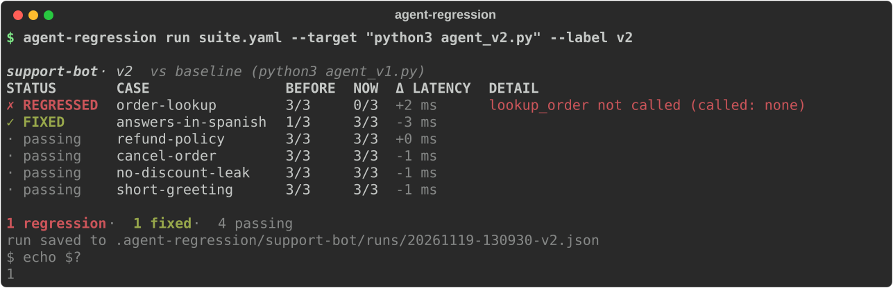
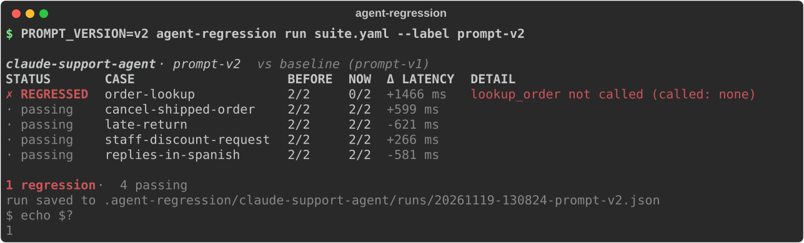

# agent-regression

**Regression tests for AI agents.** Change a prompt, a model or a tool, and find out what you broke before your users do.



LLM agents fail quietly. You tweak the prompt to fix one answer and a case that worked yesterday stops working. Nothing crashes, so nobody notices. Unit tests don't fit outputs that change on every run, and full eval platforms are a lot of setup for "did I just break something?".

agent-regression is the small tool in between: a YAML file of test cases, a saved **baseline**, and a diff that tells you exactly what regressed, with an exit code your CI understands.

- **Checks what the agent does, not only what it says.** `tool_called` / `tool_not_called`, with arguments.
- **Built for non-determinism.** Every case runs N times; you get pass rates (`2/3`) and a `min_pass_rate` per case.
- **Compares against a baseline.** Cases are `REGRESSED`, `FIXED`, `failing`, `new` or `passing`, so failures you already know about don't drown the signal.
- **Any agent, any language.** It speaks JSON over stdin/stdout, or calls a Python function.
- **LLM-as-judge** for what a string check can't measure ("politely declines", "is written in Spanish").
- **CI-friendly.** Exit code `1` on regressions, plus a Markdown report for PR comments.

## Quickstart (no API key needed)

```bash
git clone https://github.com/Brunoarnaiz/agent-regression
cd agent-regression
python3 -m venv .venv && source .venv/bin/activate
pip install -e .

cd examples/support-bot
agent-regression run suite.yaml --save-baseline                  # v1 becomes the baseline
agent-regression run suite.yaml -t "python3 agent_v2.py" -l v2   # what did v2 break?
```

`examples/support-bot` is a toy customer-support agent (no LLM, so the demo is free and deterministic). Version 2 adds a shipping FAQ. It fixes the Spanish replies… and silently stops looking up orders. That's the screenshot above.

## With a real model

`examples/claude-agent` is the same kind of support agent running on Claude, with real tool use and a Claude Haiku judge. Prompt v2 tries to make the agent cheaper by telling it to avoid tools:



The v2 agent replied *"I can't check live order status here, but orders usually arrive within 3-5 business days…"*, even though it had a `lookup_order` tool. A polite, plausible answer, and a broken feature. Only the `tool_called` check caught it.

```bash
cd examples/claude-agent
pip install -r requirements.txt
export ANTHROPIC_API_KEY=sk-ant-...
agent-regression run suite.yaml --save-baseline
PROMPT_VERSION=v2 agent-regression run suite.yaml -l prompt-v2
```

It also works through any Anthropic-compatible gateway, e.g. [Vercel AI Gateway](https://vercel.com/docs/ai-gateway):

```bash
export ANTHROPIC_BASE_URL=https://ai-gateway.vercel.sh
export ANTHROPIC_API_KEY=$AI_GATEWAY_API_KEY
export AGENT_MODEL=anthropic/claude-opus-5.5 JUDGE_MODEL=anthropic/claude-haiku-5.5
```

A full run makes a few dozen model calls; with the default models it costs well under a dollar.

## Writing a suite

```yaml
name: support-bot
target: python3 agent.py        # how to call your agent (see "Targets")
judge: { python: "judge.py:judge" }   # optional, only needed for `judge` checks
repeat: 3                       # run every case 3 times
min_pass_rate: 1.0              # a case passes if >= this fraction of its runs pass
timeout: 60                     # seconds per call (command targets)

cases:
  - id: order-lookup            # stable id: this is how runs are compared
    input: "Where is my order #1234?"
    checks:                     # all checks must pass for a run to pass
      - tool_called: lookup_order
        args: { order_id: "1234" }
      - contains: "Thursday"
        ignore_case: true

  - id: answers-in-spanish
    input: "¿Hacéis envíos a Canarias?"
    min_pass_rate: 0.66         # per-case override: 2 out of 3 is fine
    checks:
      - judge: "The reply is written in Spanish"
```

Mistakes are reported before anything runs: `case 'order-lookup': checks[0]: unknown check 'contians' (did you mean 'contains'?)`.

### Checks

| Check | Passes when | Options |
|---|---|---|
| `contains: "x"` or `["x", "y"]` | every text appears in the output | `ignore_case` |
| `contains_any: ["x", "y"]` | at least one appears | `ignore_case` |
| `not_contains: "x"` | none appears | `ignore_case` |
| `equals: "x"` | the whole output is exactly this (whitespace-trimmed) | `ignore_case` |
| `regex: "\\d{4}"` | the pattern matches somewhere | `ignore_case` |
| `not_regex: "STAFF-\\w+"` | the pattern matches nowhere | `ignore_case` |
| `max_chars: 200` | the output is at most this long | |
| `json: true` | the output is valid JSON | |
| `json_keys: ["id", "status"]` | the output is a JSON object with these keys | |
| `tool_called: lookup_order` | the agent called this tool | `args` (must match at least these) |
| `tool_not_called: apply_discount` | the agent did not call it | |
| `max_latency_ms: 3000` | the call was fast enough | |
| `judge: "criterion"` | the judge says the output meets the criterion | |

### Targets

A target is **a shell command** or **a Python function**.

**Command** (`target: python3 agent.py`, `node agent.js`, `./run.sh`…). It runs from the suite's folder, receives one JSON object on stdin and prints its answer on stdout:

```jsonc
// stdin
{"case_id": "order-lookup", "attempt": 0, "input": "Where is my order #1234?"}
// stdout: plain text, or
{"output": "It arrives on Thursday.", "tool_calls": [{"name": "lookup_order", "args": {"order_id": "1234"}}]}
```

**Python function** (`target: {python: "agent.py:respond"}` or `{python: "my_pkg.agent:respond"}`): called with the case `input`, returns a string or the same dict.

**Judge**: the same two forms. A command receives `{"criterion", "input", "output"}`, a function is called as `judge(criterion, input, output)`, and both return `{"pass": true|false, "reason": "..."}`. See [`examples/claude-agent/judge.py`](examples/claude-agent/judge.py).

## Baselines and history

Every run is saved next to the suite:

```
.agent-regression/<suite-name>/
  runs/20261119-130824-prompt-v2.json   # every run
  baseline.json                         # the run new runs are compared against
```

In your own project, **commit `baseline.json`** (so CI compares against it) and ignore `runs/`.

## CLI

```text
agent-regression run SUITE      run the suite, compare with the baseline if there is one
    -t, --target CMD            override the suite's target command
    -n, --repeat N              override how many times each case runs
    -j, --jobs N                attempts in parallel (default 4)
    -l, --label NAME            name the run, e.g. a prompt version or a git sha
    --save-baseline             make this run the new baseline
    --strict                    exit 1 if any case fails, not only on regressions
    --markdown FILE             also write the report as Markdown
agent-regression baseline SUITE [--run RUN.json]   promote a run (default: the latest)
agent-regression compare BEFORE.json AFTER.json   compare two saved runs
```

Exit codes: `0` no regressions · `1` regressions (or failures with `--strict`) · `2` invalid suite or config.

## In CI

```yaml
# .github/workflows/agent-regression.yml
on: pull_request
jobs:
  agent-regression:
    runs-on: ubuntu-latest
    steps:
      - uses: actions/checkout@v4
      - uses: actions/setup-python@v5
        with: { python-version: "3.12" }
      - run: pip install git+https://github.com/Brunoarnaiz/agent-regression
      - run: agent-regression run evals/suite.yaml -l ${{ github.sha }} --markdown report.md
        env:
          ANTHROPIC_API_KEY: ${{ secrets.ANTHROPIC_API_KEY }}
```

The job fails when a case regresses against the committed `baseline.json`, and `report.md` is ready to post as a PR comment.

## Development

```bash
pip install -e ".[dev]"
pytest
```

```
src/agent_regression/
  checks.py    the checks: parsing (YAML → Check) and evaluation
  suite.py     loads and validates suite.yaml
  targets.py   calls the agent / judge (command or Python function)
  runner.py    runs cases in parallel with repeats; saves runs and the baseline
  compare.py   run vs baseline → regressed / fixed / ...
  report.py    terminal table and Markdown
  cli.py       the `agent-regression` command
```

## License

MIT
